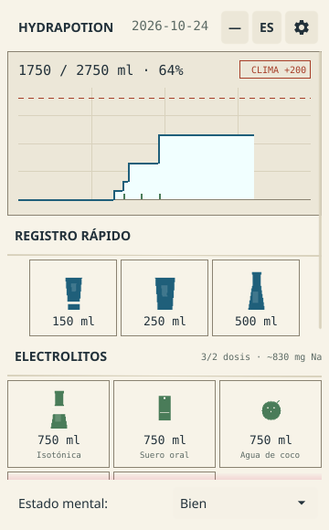

# Hydrapotion

A small Linux desktop app that logs daily water intake and draws it as a
USGS-style hydrology report — one binary, no Electron, no account, no telemetry.




## Features

**Logging**
- One-click 150 / 250 / 500 ml cards with intraday log (`history.json`)
- Electrolytes too: four one-tap servings — isotonic drink, oral rehydration
  solution, coconut water, broth — each with an estimated-sodium readout
  (`x/y servings · ~z mg Na`); a daily reference of 2 servings (3 on ≥ 30 °C
  days) and moss ticks on the hydrograph mark every serving
- CLI: `hydrapotion add 250` for water, `hydrapotion electro 250` for
  electrolytes — log without opening the window
- System tray with quick-add (water + an electrolyte item)

**Daily goal**
- Base 35 ml/kg + height, mood and weather adjustments (formula below)
- Weekly summary panel with goal line and average

**Reminders**
- Dynamic interval: adapts to time of day (×0.7 afternoon, ×2.0 night) and
  heat (×0.5 at ≥35 °C); configurable base 1–3 h; clamped 30 min–6 h
- systemd user timer mode: `hydrapotion --remind` every 15 min — the GUI can
  stay closed (~0 MB resident; each tick is a <1 s, ~10 MB process)

**Interface & data**
- "Hidrógrafo" theme (see DESIGN.md): bone paper, iron ink, stepped hydrograph
  of the day vs dashed capacity line, weather stamp, mono numerals
- UI follows the system locale (English / Spanish / Chinese)
- Export CSV (`date, ml, mood, electrolytes ml, est. sodium mg` — headers and
  mood values localized to the UI language) and JSON
- Sounds embedded in the binary (extracted to `~/.hydrapotion/sounds` on first
  run); toggle in Settings → Sounds
- Runs on X11 and native Wayland (Fyne v2.8.2 stable)

## Installation

### 1. From a release (recommended)

Grab the latest asset from [Releases](https://github.com/MoriNo23/hydrapotion/releases):

```bash
# Debian/Ubuntu — .deb installs the binary, icon, .desktop entry and user units
sudo apt install ./hydrapotion_2.0.1_amd64.deb

# or the loose binary
chmod +x hydrapotion && ./hydrapotion

# or the tarball (manual, no root)
tar -xzf hydrapotion-v2.0.1-linux-amd64.tar.gz && cd hydrapotion-v2.0.1-linux-amd64
./packaging/systemd/install-timers.sh
```

Verify checksums: `sha256sum -c checksums.txt`.

### 2. Dependencies

| Purpose | Debian / Ubuntu | Notes |
|---|---|---|
| **Run** (GUI) | `libgl1 libx11-6 libxcursor1 libxrandr2 libxinerama1 libxi6 libxxf86vm1 libxfixes3` | declared by the `.deb` |
| **Run** (Wayland session) | `libwayland-client0 libxkbcommon0` | preinstalled on desktop systems |
| **Run** (reminders/sound, optional) | `libnotify-bin pulseaudio-utils` | `notify-send`, `paplay` |
| **Build** | `golang-go` (1.24+) + `libgl1-mesa-dev xorg-dev libwayland-dev libxkbcommon-dev libegl-dev` | `sudo apt install ...` |

The `.deb` declares the run-time dependencies for you; the build list is only
needed to compile from source.

### 3. From source

```bash
git clone https://github.com/MoriNo23/hydrapotion && cd hydrapotion
make build        # or: go build -ldflags "-s -w" -o hydrapotion .
make test         # unit tests (goal formula + reminder intervals)
./hydrapotion
```

## Usage

1. Open the app, set **weight** and **height** in Settings (gear icon)
2. Tap a card to log water; pick a **mood** — it adjusts today's goal
3. After heavy sweating, tap an **electrolyte** serving (isotonic, ORS,
   coconut water, broth) — tracked separately from water, with estimated sodium
4. Optionally search your **city** for the weather adjustment
5. Enable the systemd timer so reminders fire without the GUI:

```bash
systemctl --user daemon-reload
systemctl --user enable --now hydrapotion-reminder.timer
systemctl --user list-timers | grep hydrapotion
```

All data stays in `~/.hydrapotion/` (`settings.json`, `history.json`,
`state.json`, `weather.json`). Uninstall: `sudo dpkg -r hydrapotion` or
`./packaging/systemd/uninstall-timers.sh`.

## How the goal is calculated

```
goal = 35 ml/kg            (base, body weight)
     + 5 ml per cm > 150   (height)
     + 400 ml if mood = tense · 200 ml if low
     + 200 / 400 / 600 ml  (temperature ≥ 25 / 30 / 35 °C)
     + 100 ml              (humidity > 60%)
```

The reminder interval uses the same weather logic (see
`internal/reminder`); both formulas are pure, unit-tested Go
(`internal/goal`, `internal/reminder`).

## Electrolytes

Electrolyte intake is tracked **separately from water** (it does not count
toward the water goal). Five predefined servings ship with the app, each with
an estimated sodium content based on typical concentrations:

| Serving | Volume | Est. sodium |
|---|---|---|
| Isotonic drink | 500 ml | ~250 mg Na |
| Oral rehydration solution (WHO-style) | 250 ml | ~430 mg Na |
| Coconut water | 250 ml | ~105 mg Na |
| Broth | 250 ml | ~500 mg Na |
| Pinch of salt (in water you already logged) | — | ~150 mg Na |

Servings are not rigid: **drinks follow the last water you logged** — a glass
(~250 ml), a gym thermos (~750 ml), whatever you just drank — and the cards
show that live volume; the sodium estimate scales with it. With no water
logged yet they fall back to their default volume. The pinch of salt adds
only sodium (the water was already counted as water).

Daily reference: **2 servings**, +1 when the configured weather reads ≥ 30 °C
(`internal/electro`, pure and unit-tested). The header shows
`x/y servings · ~z mg Na`; the CSV export adds the day's electrolyte volume
and estimated sodium. Arbitrary CLI volumes
(`hydrapotion electro <ml>`) are estimated at ~0.5 mg Na per ml.

All sodium figures are **rough informational estimates**, not measurements
and not dietary advice — for actual sodium intake, read the label of what
you drink.

**Plausibility check** (descriptive, not a clinical validation): the base
35 ml/kg line sits inside the common clinical estimate band of 30–40 ml/kg/day
and crosses the published adult adequate-intake values (EFSA 2010: 2.0/2.5 L;
NAM 2004: 2.7/3.7 L) at typical adult weights — 57 kg / 71 kg / 77 kg /
106 kg respectively. See [docs/goal-plausibility.png](docs/goal-plausibility.png).
Outside that weight range the formula simply extrapolates a heuristic.

## Privacy

- **What leaves the machine:** nothing, unless you search a city. The city
  search queries `geocoding-api.open-meteo.com`, and the chosen coordinates
  query `api.open-meteo.com` (current temperature + humidity). No API key, no
  account, no analytics, no GPS/IP-based location — you type the city.
- **What stays local:** everything else — settings, history, weather cache —
  in `~/.hydrapotion/`. Exports are written where you choose.
- **Reminders** run entirely offline (`--remind` only reads local state).

## Disclaimer

hydrapotion is a personal tracker, **not a medical device and not medical
advice**. Its goal is a heuristic (35 ml/kg plus small adjustments), not a
validated clinical recommendation. For health conditions, medication or
pregnancy, ask a qualified professional how much water *you* should drink.

## License

[MIT](LICENSE) © MoriNo23
